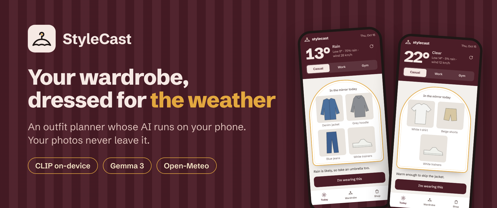
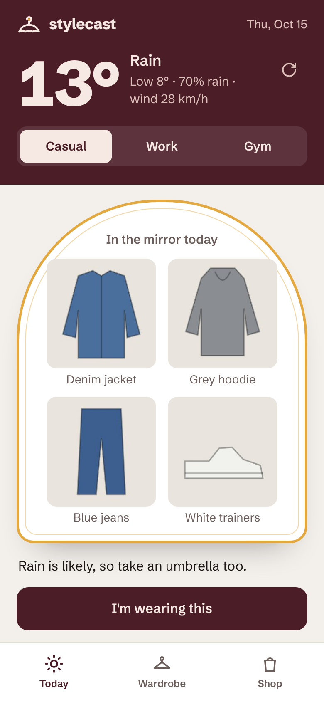
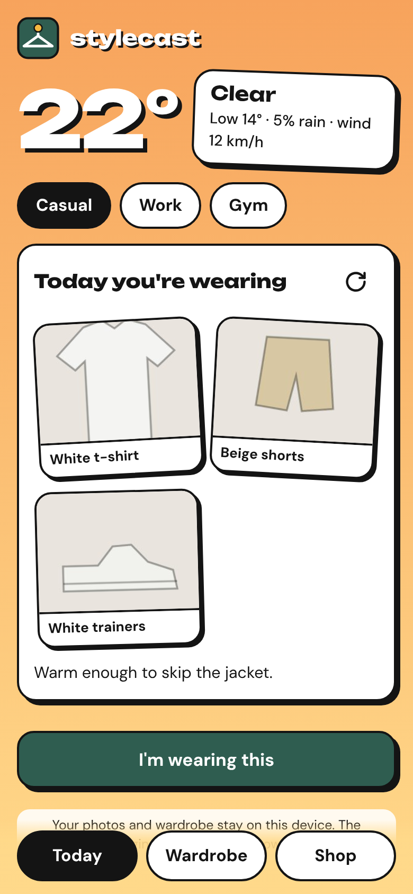
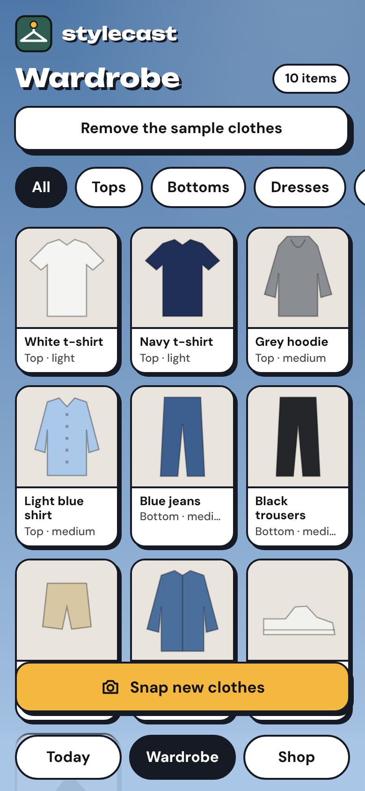
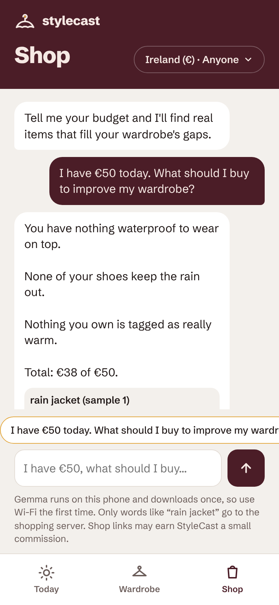

# StyleCast



Photograph your wardrobe once. Every morning, get an outfit from your own clothes that fits the real forecast.

**Try it:** https://srg-cy.github.io/StyleCast/ (tap "Add sample clothes to try it out" to see it work without photographing anything). It works best in Chrome on a laptop or Android phone.

Built for the DEV Hacktoberfest 2026 Open-Source AI Challenge, Week 2 ("Side Hustle"), entered for the Gemma, Render and SerpApi prize categories.

<p>
  
  
  
  
</p>

Today's outfit stands in a fitting-room mirror under the forecast; the wardrobe hangs on rails, one per category.

## What it does

- **Wardrobe scan:** snap each item. An open model running in your browser tags type, colour, warmth, waterproofing and formality. Every tag is editable.
- **Daily outfit:** checks today's forecast (rain, wind, temperature) and your occasion (casual, work or gym), then picks an outfit from your wardrobe.
- **Wear history:** remembers what you wore recently so it doesn't repeat, and lets you mark items "in the wash".
- **Gap spotting:** tells you what your wardrobe is missing for the weather you actually get ("nothing waterproof for days like today").
- **Budget chat (Shop tab):** say "I have €50 today, what should I buy?" and get two or three real products that fill your gaps, within budget, with a short reason for each and what it goes with in your wardrobe.

## Why not just ask ChatGPT?

A chat forgets your wardrobe the moment you close it. StyleCast remembers every item, checks the weather by itself, tracks what you've worn, and has the outfit ready before you ask.

## Runs in your browser

There's nothing to install and no account. Open the link on your phone, photograph your clothes, done.

- The tagging AI runs on your phone or laptop (WebGPU on computers that have it; WebAssembly with the 16-bit model on phones, loaded one half at a time to stay within mobile memory limits). The model downloads once (about 300 MB on phones) and the browser keeps it.
- Photos and the wardrobe are stored in your browser (IndexedDB). Nothing is uploaded, and there is no server to pay for.
- The forecast comes from Open-Meteo, called straight from the browser.
- The budget chat uses Gemma, also running on your device. Only short search words like "rain jacket" (and a price cap) go to StyleCast's small shopping server, which asks Google Shopping through SerpApi. Photos and the wardrobe list never leave the device.
- It installs like an app: on Android, tap "Install" (or Chrome's menu > Add to Home screen); on iPhone, Share > Add to Home Screen. It gets its own icon, opens full screen, and works offline after the first visit (using the last saved forecast).

## Open models

| Job | Model | Licence |
|---|---|---|
| Tagging clothes from photos | [CLIP ViT-B/32](https://huggingface.co/Xenova/clip-vit-base-patch32) via [Transformers.js](https://github.com/huggingface/transformers.js) | MIT / Apache 2.0 |
| Budget chat: planning searches, explaining picks | [Gemma 3 1B](https://huggingface.co/onnx-community/gemma-3-1b-it-ONNX-GQA) on WebGPU, [Gemma 3 270M](https://huggingface.co/onnx-community/gemma-3-270m-it-ONNX) without it, via Transformers.js | Gemma Terms of Use |
| Shopping results | SerpApi (Google Shopping), called from the shopping server on Render | Paid API, free tier |
| Weather | Open-Meteo (free, no key) | CC BY 4.0 |

CLIP picks the clothing type and colour from fixed lists, comparing the photo with a few plain descriptions of each (js/labels.js). Photos are padded to a square rather than cropped, so tall items like jeans stay whole. On 272 labelled product photos:

| Device | Right clothing type | Right category (top, bottom, shoes...) |
|---|---|---|
| Phone (WebAssembly, 16-bit) | 77% (was 55%) | 93% (was 90%) |
| Laptop (WebGPU) | 77% (was 72%) | 93% (was 92%) |

The "was" column is before the labels and preprocessing fix in #12. `node scripts/accuracy.mjs` measures it, and the Tagging accuracy workflow runs it on every pull request that touches the tagger. Each type carries the other tags (warmth, waterproof, formality), and every tag is editable. Outfits are picked by rules: weather first, then occasion, then what you haven't worn lately.

In the budget chat, Gemma reads your wardrobe and the gaps the rules found, and plans up to three searches. Rules then pick one product per search so the total never goes over budget, and Gemma explains the picks. If Gemma can't load, the rules plan the searches and write a plain explanation instead.

## Side hustle model

Free tier with a few outfits a week; about €2–3/month for daily outfits and trip packing lists. Because the AI runs on the user's device, serving one more user costs nothing. The Shop tab's product links are the second income stream: with an affiliate programme, each purchase from a wardrobe gap earns a commission. The shopping server is the one running cost, and it's capped per day.

## Run it

It's a static site, so any web server works:

```bash
python -m http.server 8000
```

Open http://localhost:8000. Add `?mock=1` to skip the model download (every photo gets placeholder tags), which is handy for working on the page.

To publish it, turn on GitHub Pages for the `main` branch (Settings > Pages > Deploy from a branch > `main` / root). GitHub then shows the app's link on that page (`https://<user>.github.io/<repo>/`).

Add `?shop=http://localhost:3000` to use a local shopping server (see below). With `?mock=1`, the chat also skips Gemma and the server and shows sample products.

### Shopping server (Render)

`server/` is a tiny Node service with no packages. It keeps the SerpApi key off users' phones, caches each search for 6 hours, and caps searches per IP and per day to protect the SerpApi quota.

```bash
cd server
MOCK=1 node index.mjs                # sample products, no key needed
SERPAPI_KEY=your-key node index.mjs  # real Google Shopping results
```

To deploy it, open Render > New > Blueprint and pick this repo; `render.yaml` sets up a free web service called `stylecast-shop`. Paste your SerpApi key into `SERPAPI_KEY` when Render asks. The app expects the service at `https://stylecast-shop.onrender.com`; if Render gives it a different address, change `SHOP_API` in `js/chat.js`. If the app is hosted somewhere other than GitHub Pages, add its address to `ALLOWED_ORIGINS`. The free plan sleeps when idle, so the first search after a quiet spell takes up to a minute; the chat says so while it waits.

`browser-test.html` is a separate page for measuring tagging speed and accuracy, comparing CLIP with SmolVLM.

## Tests

```bash
npm test
```

Runs the outfit rules, the budget chat's rules and the shopping server with Node's built-in test runner (Node 20+). No packages to install.
GitHub Actions runs the same tests on every pull request and on each push to `main`.

## Licence

MIT. See [LICENSE](LICENSE).

## Status

Built Oct 14–18, 2026 and live:

- App: https://srg-cy.github.io/StyleCast/ (GitHub Pages, from `main`)
- Shopping server: https://stylecast-shop.onrender.com (Render, free plan)

First users were two friends tagging their own clothes on Android phones. iPhone Safari hasn't been tested yet. See [PLAN.md](PLAN.md) for how the week went.
